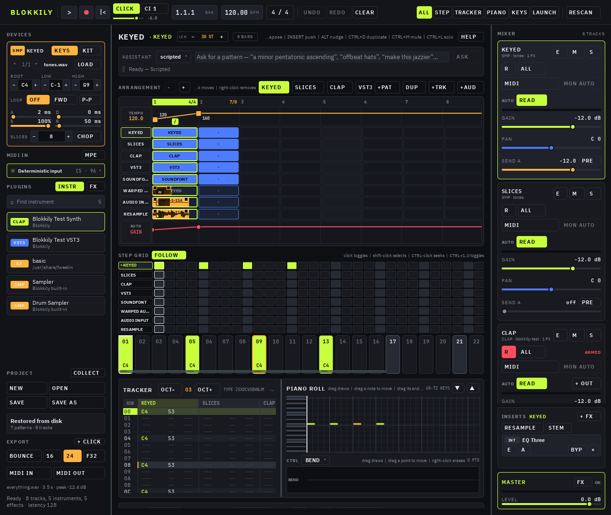

# Blokkily

Blokkily is an experimental pattern-based DAW. You can edit the same pattern in
a tracker, piano roll or step grid, then arrange patterns across multiple
tracks. It supports CLAP and VST3 plugins, SoundFont instruments and built-in
samplers. CLAP support is required in every build.

**[Watch a short video](https://www.youtube.com/watch?v=_mbjwN5OBEg)** (with
sound) of an agent building a funky chiptune in Blokkily over
[MCP](docs/mcp.md), using the [YANES](https://github.com/andrewfader/yanes) and
[FUZZBOI](https://github.com/andrewfader/fuzzboi) CLAP synths.



The screenshot comes from the `bdd_session_everything` verification session.
It shows an eight-track arrangement with a tempo ramp and warped and recorded
audio clips, the step grid, tracker and piano roll, the sampler, the plugin
browser and the mixer, with the composition assistant's prompt bar above the
editors.

## Download

Each [release](https://github.com/andrewfader/blokkily/releases/latest)
carries packages built and tested by CI:

- **Linux:** `blokkily-<version>-Linux.tar.gz` (or `.tar.xz`), built on Arch
  Linux. It expects Qt 6, FluidSynth, RtAudio, RtMidi, JACK, libsndfile,
  libsamplerate and Rubber Band from the system.
- **Windows:** `blokkily-<version>-Windows-x64-setup.exe`, an installer with a
  Start-menu entry and an uninstaller, or `blokkily-<version>-Windows-x64.zip`
  to unzip anywhere and run `bin\blokkily.exe`.
- **macOS:** `blokkily-<version>-macOS-arm64.dmg` for Apple Silicon, or
  `blokkily-<version>-macOS-x86_64.dmg` for Intel Macs, each a self-contained
  `Blokkily.app`. It is signed ad hoc, not notarized, so macOS blocks the first
  launch. Either Control-click the app and choose Open, or run
  `xattr -dr com.apple.quarantine /Applications/Blokkily.app`.

`SHA256SUMS` lists every package's checksum.

To make a self-contained Linux package, `packaging/appimage/build-appimage.sh`
turns a Release build into an AppImage, and
`packaging/flatpak/dev.blokkily.Blokkily.json` builds a Flatpak with
`flatpak-builder`. See [usage](docs/usage.md#packages).

Plugin editors work in every package. CI opens the suite's test CLAP and VST3
editors, and the editors of a real third-party synth (Dexed), in a real window
on macOS and Windows and reads their pixels back. Retina and high-DPI scaling
have not been checked there yet.

## Build and run

You need CMake 3.25+, Qt 6.5+, plus FluidSynth, RtAudio, RtMidi, libsndfile,
libsamplerate and Rubber Band 4 (found through pkg-config), and on Linux
libjack (JACK or PipeWire's JACK). JUCE and the CLAP
headers are vendored under `third_party/`, so clone with `--recursive`.

The verification tests need a SoundFont. CMake looks for `basic.sf2`,
`TimGM6mb.sf2` or `FluidR3_GM.sf2` in `/usr/share/fweelin`,
`/usr/share/sounds/sf2` and `/usr/share/soundfonts`; otherwise pass
`-DBLOKKILY_TEST_SF2=/path/to/bank.sf2`. They also need `ffmpeg` on `PATH`
to check the scope video export, and configuring fails without it.

```sh
cmake -S . -B build -G Ninja
cmake --build build
ctest --test-dir build --output-on-failure
./build/blokkily
```

`./build/blokkily_cli` runs the headless scheduler demo.

Linux is the primary platform. macOS builds with Homebrew's Qt and libraries,
and Windows builds with MSVC, vcpkg and the official Qt binaries. The CI
workflows in `.github/workflows/` (`platforms.yml` and `release.yml`) show the
exact commands for each.

Clip warping links the Rubber Band Library, licensed under the GPL (version 2
or later) unless you buy a commercial licence from its authors. A Blokkily
binary built with it is therefore subject to the GPL.

IBM Plex Sans and JetBrains Mono are bundled in `resources/fonts/` under the
SIL Open Font License 1.1, with licence texts beside them. Bundling the fonts
keeps the layout consistent across desktops.

## What you can do

- Edit notes and chords in any of the three synchronized editors. Patterns
  support inversions, strum, swing, microtiming, probability, ratchets, loop
  conditions and parameter locks, which can also move an insert on a return
  or the master bus. Edits are heard during playback without
  stopping it.
- Arrange named patterns and audio clips on a multi-track timeline, with tempo
  steps, ramps and meter changes. LOOP wraps playback between IN and OUT on
  the arrangement; an export still writes the whole song. The scene launcher
  lets you perform patterns live, give a scene its own tempo, and record the
  performance into the arrangement.
- Play and record with a MIDI controller or the on-screen piano, isomorphic
  grids, fretboards and chord pads. Tunings and scales include microtonal
  options. A session with no instruments uses an installed SoundFont by
  default, preferring a General MIDI bank when available.
- Load CLAP, VST3, LV2 and SoundFont instruments, or use the keyed and drum
  samplers. CLAP and VST3 plugins open their own editors, embedded in a
  Blokkily window on Linux, macOS and Windows.
- Mix with inserts (including built-in EQ, delay, reverb, compressor, true-peak limiter,
  resonant filter, saturation, chorus, flanger and gate),
  sends, returns, sidechains, auxiliary outputs, automation and modulation.
  Plugin latency is compensated in playback and export.
- On Linux, play through ALSA, PulseAudio or JACK. Blokkily drives JACK (and
  PipeWire's JACK) directly, at whatever block size the server runs. See
  [audio system](docs/usage.md#audio-system).
- Warp audio clips to follow the tempo, or stretch and pitch-shift them.
- Play hardware synths and drum machines from a track through a MIDI output,
  and send them MIDI clock, or follow another machine's clock.
- Record audio and MIDI (including MPE and poly pressure), with a metronome and
  count-in. Resample a bus or bounce stems. Export the arrangement
  as 16-bit, 24-bit or 32-bit float WAVE, MP3 or Ogg Vorbis through the same
  engine used for playback, every track as a file of its own (STEMS), or an
  oscilloscope video of every track over the master (SCOPE VIDEO, encoded by
  `ffmpeg` on `PATH`). Import and export Standard MIDI Files for note exchange.
- Save named versions of the song and restore any of them in one undo step,
  and keep notes with it, in the VERSIONS and NOTES tabs.
- Read any part as staff notation in the SCORE view: all eleven clefs from
  French violin to percussion, any key, any meter or unmetered chant, chords,
  voices, ties, accidentals and lyrics in any script, with the clef, key and
  meter saved with the song. Bring a hymn or a choral score in from notation
  software with SCORE IN, and send the song out with SCORE OUT, as MusicXML.
- Press F1 or HELP for a guided tour of the window. CLEAR empties the session
  in one undo step.
- Press GUIDE for a mascot that narrates what you and your agent do and why,
  answers theory questions and teaches short interactive lessons.
- Ask the LLM composition assistant for a phrase. Review its proposal before
  applying it; each generation is one undo step. An MCP bridge also lets agents
  control the running application and measure what they render (loudness,
  true peak, band energy).

See the [usage guide](docs/usage.md) for controls, keyboard shortcuts and
recording workflows.

## Current limitations

Blokkily is experimental. MPE support varies by instrument format. Large
unwarped audio clips can stream from disk; warped clips and sampler samples
still load into memory. On Linux, plugin editor windows need X11, or Wayland
with XWayland or a CLAP plugin's own Wayland support. Export always renders
the arrangement, so record a launcher performance into it before exporting.

The [limitations reference](docs/limitations.md) covers these restrictions and
others, including sidechains, modulation timing, sampler editing and stems.

## Documentation and development

- [Usage guide](docs/usage.md): editing, arranging, recording, mixing and shortcuts.
- [Architecture](docs/architecture.md): the shared model, scheduler, plugin
  adapters and coverage commands.
- [Agent control through MCP](docs/mcp.md): setup, tools and environment variables.
- [LLM composition assistant](docs/llm-assistant.md): backends and reply format.
- [Verification](docs/verification.md): repeatable BDD, integration, end-to-end
  and screenshot checks.

Behaviour specifications live in `features/`. Repository-wide completion rules
are in [AGENTS.md](AGENTS.md).
